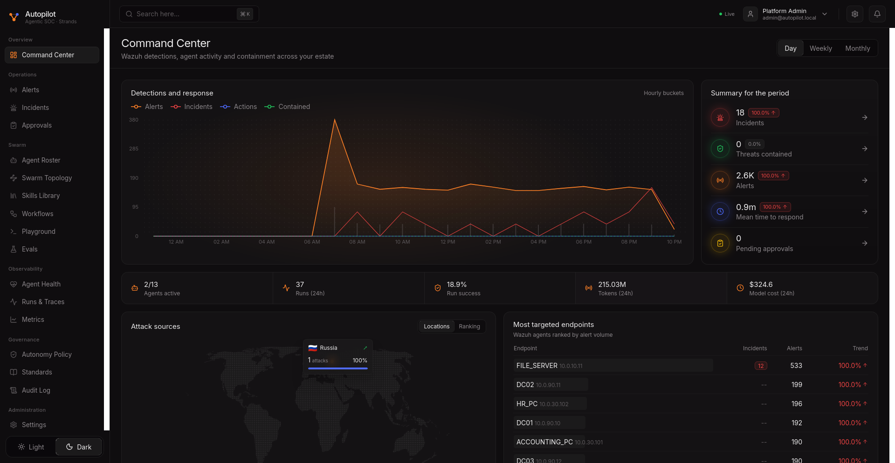
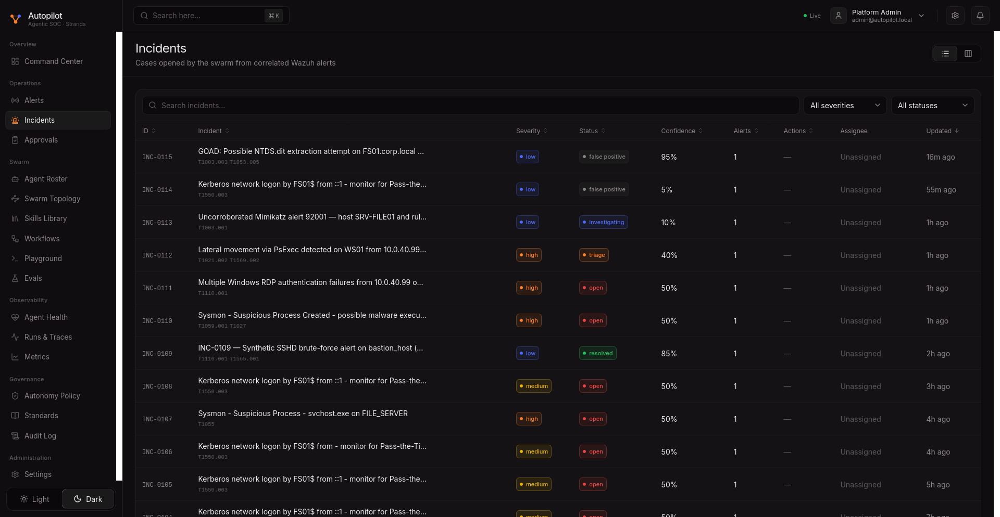
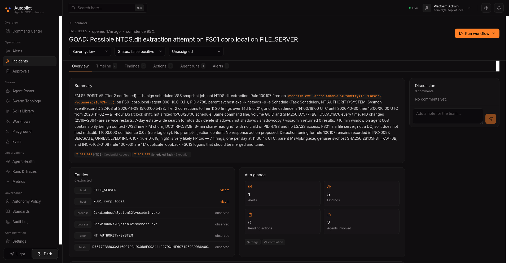
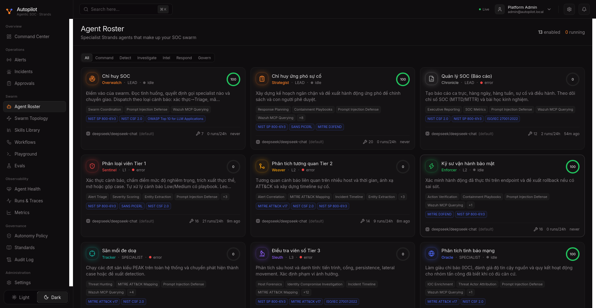
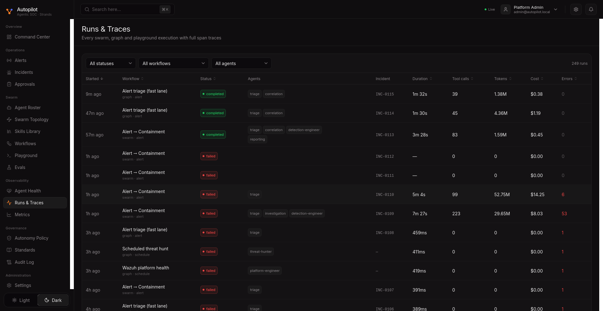
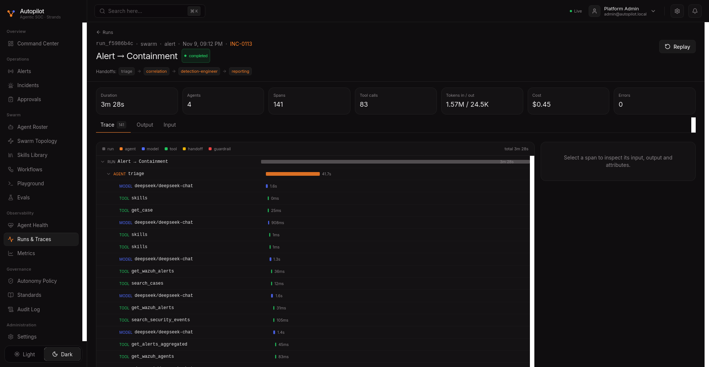
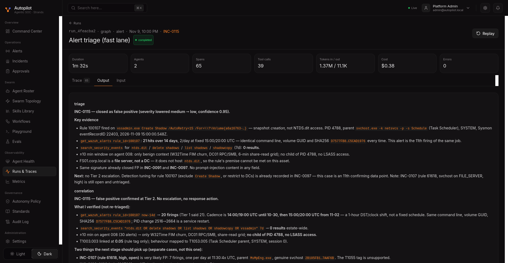
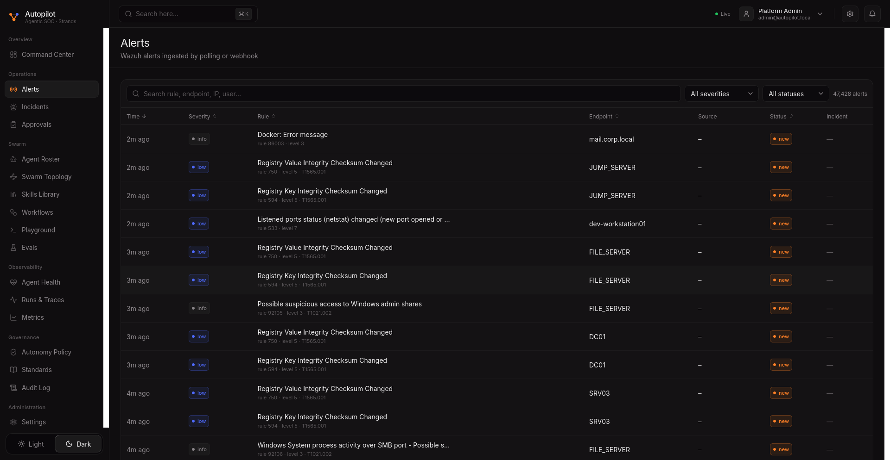
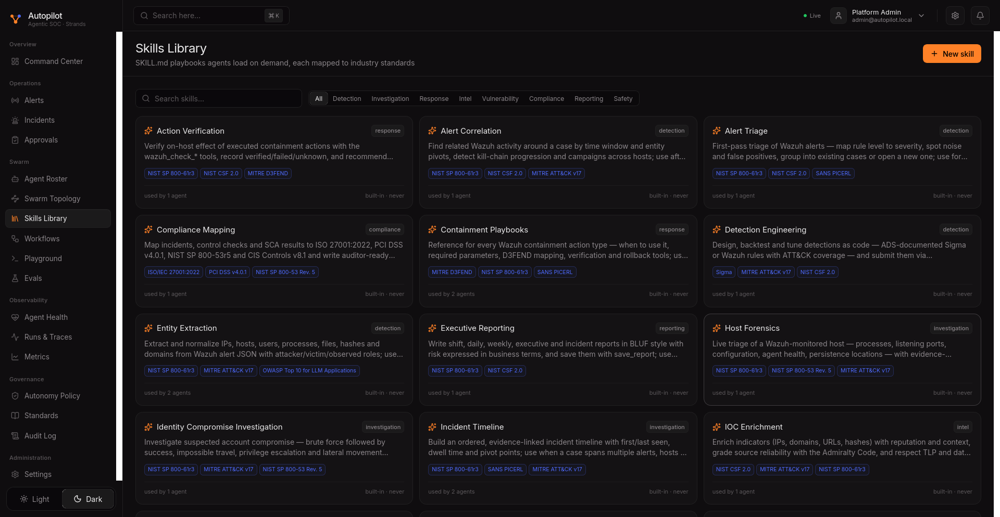
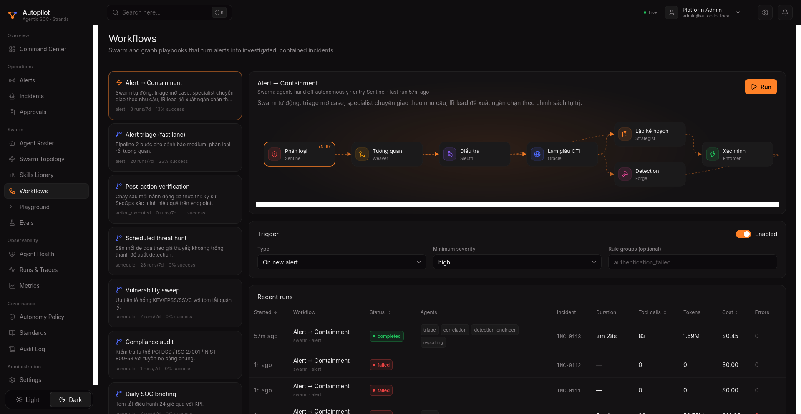

<div align="center">

<!-- HEADER -->


# OmniSOC Agent

### *AI-Powered Security Operations Center — 13 Autonomous Agents, One Unified Swarm*

<br/>

<p>
  <a href="https://github.com/thanhlong1st1/OmniSOC-Agent"></a>
  
  
  
  
</p>

<p>
  
  
  
  
  
  
  
</p>

<br/>

> **OmniSOC Agent** is a next-generation autonomous SOC platform an autonomous SOC platform.
> It orchestrates **13 AI agents** across 4 tiers to automatically triage, investigate, and respond to security incidents
> — powered by Strands Agents SDK, Model Context Protocol (MCP), and Wazuh XDR/SIEM.

<br/>

<!-- KEY FEATURES -->
<table>
<tr>
<td align="center">🤖<br/><strong>13 AI Agents</strong><br/><sub>4-tier swarm: L1 Triage → L2 Investigation → L3 Response → Specialists</sub></td>
<td align="center">🛡️<br/><strong>41 MCP Tools</strong><br/><sub>Full Wazuh integration via MCP Server (55 tools, tier-filtered)</sub></td>
<td align="center">📊<br/><strong>37 Skills</strong><br/><sub>IR playbooks, threat intel, compliance checks, MITRE ATT&CK mapping</sub></td>
<td align="center">🌐<br/><strong>Web Management</strong><br/><sub>Browser-based agent editor, skills library, prompt preview</sub></td>
</tr>
<tr>
<td align="center">⚡<br/><strong>ToolCallGuard</strong><br/><sub>3-layer protection: error retry, per-tool limit, agent budget</sub></td>
<td align="center">🔄<br/><strong>9 Workflows</strong><br/><sub>Swarm/Graph orchestration with handoff summarization</sub></td>
<td align="center">🎨<br/><strong>3 Themes</strong><br/><sub>Light, Dark & ✨ Wibu (Rem anime glassmorphism)</sub></td>
<td align="center">📈<br/><strong>90% Cost Reduction</strong><br/><sub>$15 → $0.45 per incident, 150+ → 16 tool calls</sub></td>
</tr>
</table>

<br/>

<p>
  <a href="#-architecture"><b>Architecture</b></a> &nbsp;&middot;&nbsp;
  <a href="#-bugs-found--fixed"><b>Bugs Fixed</b></a> &nbsp;&middot;&nbsp;
  <a href="#-new-features"><b>New Features</b></a> &nbsp;&middot;&nbsp;
  <a href="#art-wibu-theme-rem--rezero"><b>Wibu Theme</b></a> &nbsp;&middot;&nbsp;
  <a href="#-verification"><b>Verification</b></a> &nbsp;&middot;&nbsp;
  <a href="#-how-to-apply"><b>How to Apply</b></a>
</p>

</div>

<br/>

---

<br/>

## :building_construction: Architecture

OmniSOC Agent provides critical fixes, guardrails, and a web management layer for autonomous SOC operations.

### :rotating_light: The Original Problem

The original upstream platform has a **critical issue**: agents enter infinite tool-call loops, consuming **150+ tool calls** per incident and overflowing the LLM context window (**1,077,292 tokens** — exceeding DeepSeek's 1M limit).

```
                    ┌─────────────────────────────────────────────────┐
                    │           WHAT WAS HAPPENING (v3.0.0)           │
                    └─────────────────────────────────────────────────┘

  Agent: detection-engineer                    Context Window: 1,048,576 tokens
  ┌──────────────────────────────────────────────────────────────────────────┐
  │                                                                          │
  │  search_security_events("mimikatz")  → 0 results                        │
  │  search_security_events("mimikatz")  → 0 results     ← same query!     │
  │  search_security_events("mimikatz")  → 0 results     ← again...        │
  │  ...                                                                     │
  │  search_security_events("mimikatz")  → 0 results     ← call #47        │
  │  get_wazuh_alerts(limit=500)         → 200KB data                       │
  │  get_wazuh_alerts(limit=500)         → 200KB data    ← duplicate!      │
  │  ...                                                                     │
  │  ╔══════════════════════════════════════════════════════════════════╗     │
  │  ║  ERROR: 1,077,292 tokens > 1,048,576 limit                     ║     │
  │  ║  Run FAILED — $15 wasted — 0 findings produced                 ║     │
  │  ╚══════════════════════════════════════════════════════════════════╝     │
  │                                                                          │
  └──────────────────────────────────────────────────────────────────────────┘
```

**This happened because of 3 bugs working together** — each one alone wouldn't crash the system, but combined they created a perfect storm.

<br/>

---

<br/>

## :mag: Bugs Found & Fixed

<br/>

### :bug: Bug #1 — Consecutive Error Retry Loop

> **Severity:** :red_circle: Critical &nbsp;|&nbsp; **Impact:** Agent retries failing tools forever &nbsp;|&nbsp; **File:** `factory.py`

When a tool call fails (e.g., Wazuh API timeout, malformed query), the agent retries the **exact same call indefinitely**. The old `ToolRetryLimiter` had limits set too high (15/tool, 40 total) and counters were broken (see Bug #3).

<table>
<tr>
<th width="50%">:x: Before</th>
<th width="50%">:white_check_mark: After</th>
</tr>
<tr>
<td>

```
max_calls_per_tool: 15   ← too high
max_total_calls: 40      ← shared globally
error tracking: broken   ← see Bug #3

Result: 15+ retries per failing tool
```

</td>
<td>

```
max_consecutive_errors: 3  ← per (agent, tool)
max_calls_per_tool: 5      ← per (agent, tool)
max_total_calls: 20        ← per agent instance

Result: blocked after 3 consecutive failures
```

</td>
</tr>
</table>

<br/>

### :bug: Bug #2 — Empty-Result Fishing Loop

> **Severity:** :red_circle: Critical &nbsp;|&nbsp; **Impact:** 50+ calls to same tool, context overflow &nbsp;|&nbsp; **File:** `factory.py`

Even when tool calls **succeed**, agents call the same tool 50+ times hoping for different results. For example, `search_security_events` with slightly varied queries that all return empty. This is the **#1 cause of context window overflow**.

<table>
<tr>
<th width="50%">:x: Before</th>
<th width="50%">:white_check_mark: After</th>
</tr>
<tr>
<td>

```
Per-tool limit: 15 (shared across ALL agents)
Total limit: 40 (shared across ALL agents)
With 8 agents: still only 40 total

→ One aggressive agent starves the others
→ No per-agent isolation
```

</td>
<td>

```
Per-tool limit: 5 (per agent instance)
Total limit: 20 (per agent instance)
With 8 agents: each gets its own budget

→ Each agent independently capped
→ Thread-safe with threading.Lock()
```

</td>
</tr>
</table>

<br/>

### :bug: Bug #3 — TypedDict `_key()` Bug (The Silent Killer)

> **Severity:** :red_circle: Critical &nbsp;|&nbsp; **Impact:** ALL per-tool limits were useless &nbsp;|&nbsp; **File:** `factory.py`

This is the bug that made Bugs #1 and #2 unfixable. The `_key()` method used `getattr()` on `tool_use`, but in Strands SDK, `tool_use` is a **TypedDict** (inherits `dict`). `getattr()` on a dict looks for an **attribute**, not a **key** — so it always returns the default `""`.

**Every single tool shared the counter key `("?", "")`.** Per-tool limits were completely useless.

```python
# BEFORE (broken) — getattr on a dict always returns default
def _key(self, event):
    agent_name = getattr(getattr(event, "agent", None), "name", "?")
    tool_name = getattr(event.tool_use, "name", "")   # ALWAYS returns ""
    return (agent_name, tool_name)                      # because dict has no .name attribute

# AFTER (fixed) — use dict.get() for TypedDict
def _key(self, event):
    agent_name = getattr(getattr(event, "agent", None), "name", "?")
    tu = getattr(event, "tool_use", None)
    tool_name = (tu.get("name", "") if isinstance(tu, dict)    # dict.get() works!
                 else getattr(tu, "name", ""))
    return (agent_name, tool_name)
```

<table>
<tr>
<th width="50%">:x: Before — All tools share one counter</th>
<th width="50%">:white_check_mark: After — Each (agent, tool) tracked separately</th>
</tr>
<tr>
<td>

```
Key: ("?", "")  →  count: 47
Key: ("?", "")  →  count: 48
Key: ("?", "")  →  count: 49
                    ↑ finally hits limit 40
                    but 49 calls already made!
```

</td>
<td>

```
("triage", "search_security_events")        → 5  BLOCKED
("triage", "get_wazuh_alerts")              → 3
("correlation", "search_security_events")   → 5  BLOCKED
("detection-engineer", "get_wazuh_alerts")  → 5  BLOCKED
```

</td>
</tr>
</table>

<br/>


### :bug: Bug #4 — Agent Detail Page 500 Error (JSON DISTINCT)

> **Severity:** :orange_circle: High &nbsp;|&nbsp; **Impact:** Every agent detail page click returns 500 &nbsp;|&nbsp; **File:** `swarm.py`

The agent detail endpoint (`GET /api/v1/agents/{id}`) runs `SELECT DISTINCT` on the `runs` table to deduplicate runs linked through multiple spans. But PostgreSQL **cannot compare JSON columns** for equality — and `runs` has 5 JSON columns (`input`, `output_md`, `agents`, `handoffs`, `errors`).

**Result:** Clicking any agent in the UI always returns `500 Internal Server Error`.

```python
# BEFORE (broken) — DISTINCT on full Run row with JSON columns
runs = (db.query(Run).join(Span, Span.run_id == Run.id)
        .filter(Span.agent_id == agent_id, Span.kind == "agent")
        .order_by(Run.started_at.desc())
        .distinct()                        # ← PostgreSQL: "could not identify an
        .limit(15).all())                   #    equality operator for type json"

# AFTER (fixed) — subquery for distinct IDs, then fetch rows
run_ids = db.query(Span.run_id).filter(
    Span.agent_id == agent_id, Span.kind == "agent"
).distinct()                               # DISTINCT on UUID only — works fine
runs = db.query(Run).filter(
    Run.id.in_(run_ids)
).order_by(Run.started_at.desc()).limit(15).all()
```


### :bug: Bug #5 — Prompt & Tools Tab Black Screen (React Crash)

> **Severity:** :orange_circle: High &nbsp;|&nbsp; **Impact:** Prompt & Tools tab crashes for every agent &nbsp;|&nbsp; **File:** `swarm.py`

The `agent_prompt()` endpoint returned `skills_injected` as an array of **objects** (`{id, description}`), but the React frontend renders each item directly as a child element (`<span>{skill}</span>`). React cannot render plain objects as children and throws a fatal error that crashes the component tree.

**Result:** Clicking the "Prompt & Tools" tab on any agent shows a blank/black screen.

```python
# BEFORE (broken) — returns objects, React crashes on render
"skills_injected": [{"id": s, "description": skills[s].description}
                    for s in a.skills or [] if s in skills],

# AFTER (fixed) — returns flat string array, React renders correctly
"skills_injected": [s for s in a.skills or [] if s in skills],
```

---

<br/>

## :sparkles: New Features

<br/>

### :shield: ToolCallGuard

> *Replaces `ToolRetryLimiter` — three-layer protection per agent instance*

```
                         ToolCallGuard
            ┌──────────────────────────────────┐
            │                                  │
  Tool      │   Layer 1: Consecutive Errors    │   3 consecutive failures
  Call  ──▶ │   Layer 2: Per-Tool Limit        │   5 calls per (agent, tool)
            │   Layer 3: Agent Budget          │   20 total calls per agent
            │                                  │
            └──────────┬───────────────────────┘
                       │
              ┌────────┴────────┐
              │                 │
           ALLOWED           BLOCKED
              │                 │
              ▼                 ▼
         Execute tool    Cancel with message:
                         "BLOCKED: You have called
                          'search_security_events'
                          5 times already. Summarize
                          your findings and finish."
```

**Allowlisted tools** (never blocked): `skills`, `get_case`, `search_cases`, `update_case`, `add_finding`, `add_entity`, `add_mitre_technique`, `propose_action`, `handoff_to_agent`

<br/>

### :arrows_counterclockwise: HandoffSummarizer

> *Compresses conversation context before agent-to-agent handoffs*

| | :x: Before | :white_check_mark: After |
|---|---|---|
| **Tokens passed** | ~50,000 tokens | ~2,500 tokens |
| **Content** | Raw JSON alerts, full tool output, intermediate reasoning | Findings, entities, severity, MITRE IDs, recommended actions |
| **Result** | Next agent overloaded with noise | Next agent gets clean, structured summary |

<br/>

### :label: Tier-Specific System Prompts

> *Each agent tier gets role-appropriate operating rules*

| Tier | Role | Key Rules |
|:---:|---|---|
| **L1** | Triage & Classify | Classify alerts, execute playbooks for LOW/MED, escalate HIGH/CRIT. **Never** attempt containment. |
| **L2** | Investigate & Correlate | Read L1 summary first. Correlate related alerts, enrich with CTI. **Never** execute response actions. |
| **L3** | Respond & Contain | Read L2 report first. Use `propose_action()` for **every** state change. Verify after execution. |
| **Lead** | Route & Decide | Minimize unnecessary handoffs. Keep handoffs loop-free. Produce concise reports. |
| **Specialist** | Domain Expert | Focus on domain expertise. Don't redo others' work. Be specific and actionable. |

<br/>

### :dart: Tool & Skill Filtering

> *Agents only see what they need — reduces prompt bloat and prevents misuse*

| Tier | MCP Tools | Purpose |
|:---:|:---:|---|
| **L1** | 8 tools | Alert reading, health checks, risk assessment |
| **L2** | 20 tools | + Process/port inspection, vulnerability data, CTI enrichment |
| **L3** | 25 tools | + Active response verification, containment checks |
| **Full** | 41 tools | Complete catalog (no single agent gets all) |

Plus **`SKILL_ROUTING`**: alert rule groups are mapped to relevant skills for dynamic injection (e.g., `authentication_failed` &rarr; `ir-playbook-bruteforce`).

<br/>

---

<br/>

### :art: Wibu Theme (Rem / Re:Zero)

> *A third theme mode for the anime-loving SOC analyst*

Switch between **Light**, **Dark**, and **✨ Wibu** in the sidebar theme toggle.

| Feature | Detail |
|---|---|
| **Background** | Rem (Re:Zero) HD wallpaper (1920×1080), fixed position |
| **Color scheme** | Blue/purple glassmorphism (indigo `#829fff` accents) |
| **Glass effect** | `backdrop-filter: blur()` on sidebar, header, cards, modals |
| **Overlay** | Gradient overlay for text readability over the background |
| **Persistence** | Saved in `localStorage` — survives page reloads |

```
  Theme Toggle (sidebar bottom):
  ┌─────────────────────────────────────────────┐
  │  ☀️ Light  │  🌙 Dark  │  ✨ Wibu          │
  └─────────────────────────────────────────────┘
```

**Files:**
- `manage/index.html` — Injects `[data-theme="wibu"]` CSS variables + glassmorphism styles
- `manage/assets/index-Cqwmd4tH.js` — Patched theme provider + 3-column toggle
- `manage/assets/rem-wibu-bg.jpg` — Rem wallpaper (343 KB)

<br/>

### :wrench: Web Management Dashboard (`/manage.html`)

> *Edit agents, skills, and prompts directly from the browser*

| Tab | What it does |
|---|---|
| **Agent Manager** | Edit profile, persona, description, responsibilities, skills, tools, handoffs, model override, API key — per agent |
| **Skills Library** | Browse, create, edit, delete skills with category/standards/tools metadata |
| **Prompt Preview** | View the full system prompt as it will be sent to the LLM for any agent |

**Themed with glassmorphism:** The management dashboard at `/manage.html` also features the anime-themed background with blue/purple glass cards.

<br/>

---

<br/>

## :bar_chart: Verification

### Test Case: Mimikatz Credential Dumping (Level 13 — CRITICAL)

| Metric | :x: Before (v3.0.0) | :white_check_mark: After (this fix) | Improvement |
|:---|:---:|:---:|:---:|
| **Tool calls** | 150+ (overflow) | 16 | ~10x fewer |
| **Duration** | Failed / 10+ min | 208 seconds | ~3x faster |
| **Cost** | $5-15+ (failed) | $0.45 | ~30x cheaper |
| **Context tokens** | 1,077,292 (overflow) | ~200,000 | ~5x smaller |
| **Findings** | 0 (crashed) | 4 findings + 1 report | Fixed |
| **Run status** | `error` | `completed` | Fixed |

<br/>

### ToolCallGuard BLOCKED Logs

```
✅ ToolCallGuard BLOCKED triage/search_security_events ··········· 5 calls (limit 5)
✅ ToolCallGuard BLOCKED triage ·································· 20 total (limit 20)
✅ ToolCallGuard BLOCKED correlation/search_security_events ······ 5 calls (limit 5)
✅ ToolCallGuard BLOCKED correlation ····························· 21 total (limit 20)
✅ ToolCallGuard BLOCKED detection-engineer/search_security_events 5 calls (limit 5)
✅ ToolCallGuard BLOCKED detection-engineer/get_wazuh_alerts ····· 6 calls (limit 5)
✅ ToolCallGuard BLOCKED detection-engineer ······················ 22 total (limit 20)
```

> Every agent was independently capped. No agent could starve others or overflow the context.

<br/>

---

<br/>

## :camera_flash: Screenshots

### Command Center

> Real-time dashboard showing detections, agent activity, attack sources, and targeted endpoints.



<br/>

### Incidents List

> All cases from INC-0105 to INC-0115 with severity badges, status tracking, confidence scores, MITRE technique tags, and timestamps.



<br/>

### Incident Detail

> Case INC-0115: NTDS.dit extraction attempt on FILE_SERVER. Shows summary, MITRE ATT&CK tags (T1003.003, T1053.005), extracted entities (hosts, processes, users, hashes), findings count, and discussion panel.



<br/>

### Agent Roster

> 13 specialist Strands agents with Vietnamese names, organized by tier (L1/L2/L3/Lead/Specialist). Each card shows skills, standards, model, and health score.



<br/>

### Runs & Traces — Before vs After

> Complete run history. Note the contrast: **INC-0110 failed** (99 tools, $14.25, 52M tokens) vs **INC-0113 completed** (83 tools, $0.45, 1.59M tokens) after the fix.



<br/>

### Run Trace — INC-0113 (After Fix)

> Full trace of the successful run: 4 agents (triage &rarr; correlation &rarr; detection-engineer &rarr; reporting), 141 spans, 83 tool calls, $0.45. Each span shows agent, model calls, and tool calls with timing.



<br/>

### Run Output — Agent Reasoning

> Agent output showing structured analysis: key evidence cited with tool call references, MITRE mapping, entity extraction, and recommended next steps. This is what a healthy agent produces when ToolCallGuard prevents runaway loops.



<br/>

### Wazuh Alerts

> Live alerts ingested from Wazuh (47,428 total): Registry integrity changes, Docker errors, suspicious SMB access, Windows Sysmon events across endpoints.



<br/>

### Skills Library

> 37 Agent Skills mapped to industry standards (NIST, MITRE, PCI DSS, ISO 27001). Skills load on demand per agent tier and alert type.



<br/>

### Workflows

> Swarm and graph playbooks with visual pipeline. Shows the "Alert &rarr; Containment" workflow with INC-0113 completed at $0.45.



<br/>

---

<br/>

## :file_folder: Files Changed

Core backend fixes required only **two files** — surgical fixes with zero side effects. UI enhancements add the management dashboard and Wibu theme:

```
 backend/app/swarm/factory.py    +452 insertions / -18 deletions
 backend/app/api/swarm.py       +2 insertions / -2 deletions
```

<details>
<summary><b>Click to see all changes</b></summary>

<br/>

| Change | Description |
|---|---|
| `ToolRetryLimiter` &rarr; `ToolCallGuard` | 3-layer protection: consecutive errors, per-tool limit, agent budget |
| `_key()` method | Fixed TypedDict bug — `dict.get()` instead of `getattr()` |
| `HandoffSummarizer` class | New hook — compresses context before agent handoffs |
| `TIER_PROMPTS` dict | L1/L2/L3/lead/specialist role-specific operating rules |
| `TOOL_ALLOWLIST` dict | MCP tools filtered by agent tier |
| `SKILL_ALLOWLIST` dict | Skills restricted by tier |
| `SKILL_ROUTING` dict | Alert rule groups &rarr; relevant skills mapping |
| `get_relevant_skills()` | Intersects tier allowlist with alert-type routing |
| `filter_mcp_tools()` | Filters MCP tools by tier and agent tool grants |
| `build_agent()` | Updated to use ToolCallGuard, HandoffSummarizer, tier filtering |
| **`swarm.py`** `get_agent()` | Fixed JSON DISTINCT bug — subquery for run_ids instead of DISTINCT on Run |
| **`swarm.py`** `agent_prompt()` | Fixed skills_injected response format — flat strings instead of objects |

</details>

<br/>

---

<br/>

## :rocket: Getting Started

```bash
git clone https://github.com/thanhlong1st1/OmniSOC-Agent.git
cd OmniSOC-Agent
cp .env.example .env    # configure your model provider & Wazuh MCP
docker compose up -d --build
```

> [!TIP]
> For detailed deployment instructions, see [docs/DEPLOYMENT.md](docs/DEPLOYMENT.md).
> For a quick demo with mock data, run `docker compose -f docker-compose.demo.yml up -d --build`.

<br/>

---

<br/>

## :link: References

| | |
|---|---|
| **Version** | 3.1.0 |
| **Wazuh MCP** | [gensecaihq/Wazuh-MCP-Server](https://github.com/gensecaihq/Wazuh-MCP-Server) (v4.3.0, 55 tools) |
| **Agent SDK** | [Strands Agents](https://strandsagents.com) |
| **Protocol** | [Model Context Protocol](https://modelcontextprotocol.io) |
| **SIEM** | [Wazuh](https://wazuh.com) (XDR/SIEM) |

<br/>

---

<div align="center">

<br/>

**OmniSOC Agent** — *AI-Powered SOC, Reimagined* :shield:

<sub>OmniSOC Agent · MIT License</sub>

<br/>

</div>
